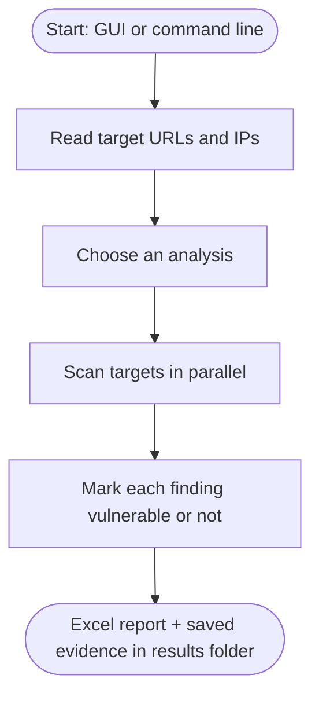

# InfraCheck

Desktop tool that checks the security of web infrastructure: HTTP security headers, HTTP methods, IP spoofing, error pages, SSL/TLS configuration and public exposure. Every run produces an Excel report.

## Features

- **Header analysis**: missing or weak security headers, CSP evaluation, HTTP/2 support and version disclosure in server banners
- **HTTP methods**: unsafe methods such as PUT, DELETE and TRACE
- **IP spoofing**: access-control bypass through spoofed client-IP headers
- **Error pages**: default or verbose server error pages
- **SSL Labs**: TLS grade, weak ciphers and certificate issues via the SSL Labs API
- **Exposure check**: hosts and IPs reachable from outside the network
- GUI and command-line modes, optional proxy, optional OpenAI lookup of current server versions

## How it works



## Requirements

- Windows
- Python 3.12 on `PATH`

## Quick start

```bat
git clone https://github.com/Faizan-Ali-code/InfraCheck.git
cd InfraCheck
run.bat
```

The first run creates a `.venv` folder and installs the packages. Put your targets in `input data\urls.txt`, one URL or host per line.

- GUI: `run.bat`
- Command line: `run.bat --cli` (menu), `run.bat --cli 1` (header analysis), `--proxy host:port` to use a proxy

Optional: set the `OPENAI_API_KEY` environment variable to check detected server versions against current releases; without it the rules in `input data\banner-version-baselines.txt` are used.

## Output

- `results\<Analysis>-Status-<date-time>.xlsx`: one workbook per run
- `results\html\`: saved responses used as evidence
- `logs\`: one log file per start

## Project structure

```
infrachecker/   Python package: scanners, GUI, Excel writer
input data/     target lists and analysis settings
run.bat         starts the app (creates .venv on first run)
```

> Only scan systems you own or are authorised to test.
